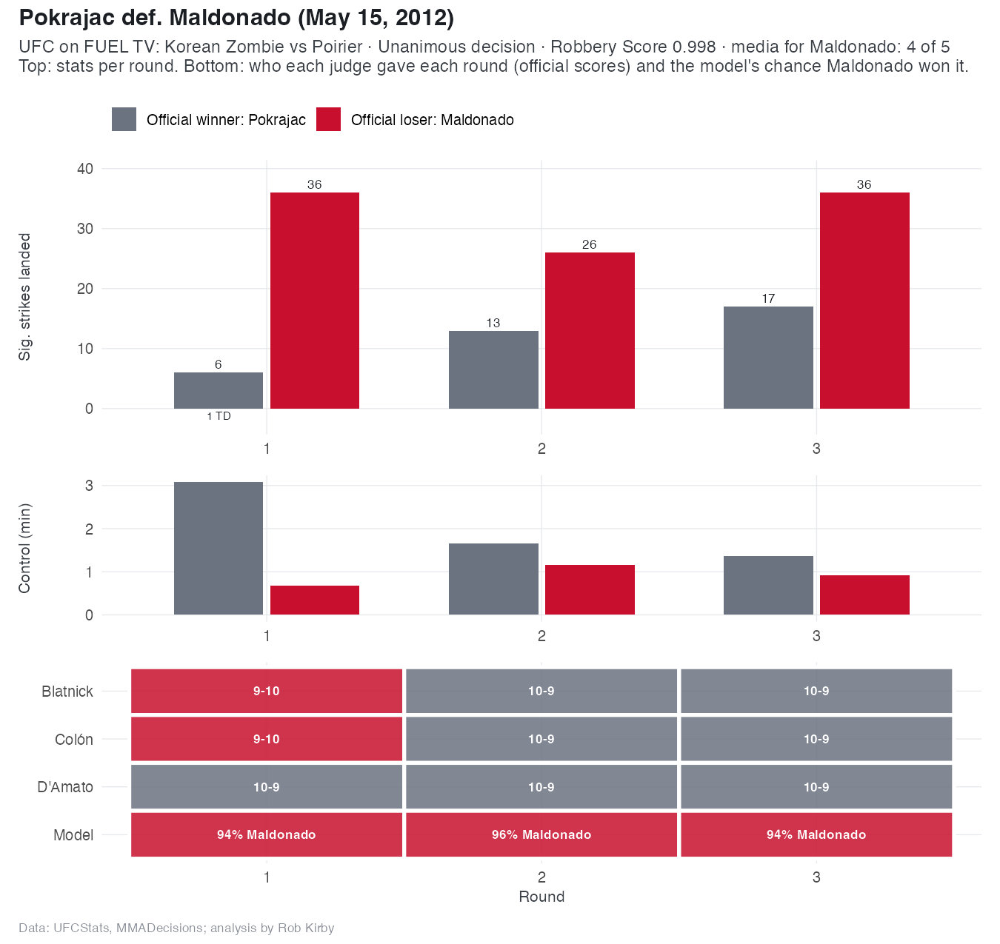

# The UFC Robbery Detector

**Which UFC decisions did the statistics say went to the wrong fighter?** A model trained on 33,444 real judges' round scores, plus a simulation of correlated judges, scores every UFC decision since 2001.

**Live site:** https://rkirbs.github.io/ufc-robbery-detector/



## What "robbery" means

> A **robbery** is a decision in which the officially declared winner had a low probability of winning given the round-by-round statistics of the fight, as estimated by a model trained on how judges actually score rounds.

**Robbery Score = 1 − P(declared winner wins the decision | fight stats).** It measures *disagreement between the statistics and the result*. It is **never an accusation** of judge misconduct: statistics can't see damage, power, octagon control or aggression.

## Headline findings

- **1 in 18 decisions is a statistical "robbery".** 225 of 4,049 decisions (5.6%) score at least 0.75. 11 of 13 widely debated decisions rank in the top 16%.
- **What judges reward:** a knockdown is worth about 12 significant head strikes, a minute of control 3.1, and a takedown 2.2. A missed takedown *costs* 0.67.
- **The model agrees with the media almost as often as the judges do** (88% vs. 90% agreement with the media majority). The Robbery Score correlates with media disagreement at r = 0.59.
- **Judges lean slightly toward the red corner (+4.7 pts on a 50/50 round) and the betting favourite (+6.5 pts for a −300 favourite).** Adjusted for round difficulty, individual judges agree with the stats at very similar rates.
- **The 2017 criteria changed what judges reward** (knockdown 9 → 15 head strikes; takedown 2.7 → 1.9), **but not how often decisions go "wrong".**

| # | Decision | Year | Robbery Score | Media for loser |
|---|---|---|---|---|
| 1 | Igor Pokrajac def. Fabio Maldonado | 2012 | 0.998 | 4 of 5 |
| 2 | Leonard Garcia def. Nam Phan | 2010 | 0.992 | 5 of 5 |
| 3 | Sergio Moraes def. Tim Means | 2018 | 0.990 | 13 of 14 |
| 4 | Tom Duquesnoy def. Terrion Ware | 2018 | 0.989 | 5 of 16 |
| 5 | Gian Villante def. Sean O'Connell | 2014 | 0.987 | 3 of 8 |

## Methods in brief

1. **Data.**
   - Round-by-round fight statistics from UFCStats, via the [Greco1899/scrape_ufc_stats](https://github.com/Greco1899/scrape_ufc_stats) mirror.
   - Every judge's round-by-round scorecard, plus media scorecards, from [MMADecisions](https://mmadecisions.com), collected with the owner's permission.
   - Closing betting lines from [BestFightOdds](https://www.bestfightodds.com).
   - In all: 4,109 decisions, 51,355 media scores.
2. **Round model.**
   - Predicts which fighter a judge gives each round, from that round's A-minus-B stat differentials only.
   - Training rounds are mirrored, so the model can't learn "red corner wins".
   - Logistic, glmnet and xgboost models (tidymodels), compared with grouped cross-validation by fight, a 2020–2026 time-based test, log-loss, Brier score and calibration. Final model: xgboost.
3. **Simulation.**
   - 10,000 sets of three judges per fight.
   - Judges are correlated (latent correlation 0.61, estimated from how often real judges split), with modelled 10-8 and 10-10 rounds and point deductions.
   - Uses out-of-fold round probabilities, so no fight's own scorecards inform its own score.
4. **Validation.** Media scorecards, round-level agreement, face validity and calibration.
5. **Judges.** Mixed models with judge random effects (shrinkage), a minimum of 100 rounds per judge, and intervals throughout.

## Reproduce it

```r
renv::restore()          # exact package versions
targets::tar_make()      # parse cached data, fit models, simulate, export data/final/
```
```bash
quarto render analysis/  # build the site into docs/
Rscript scripts/build_readme.R
```

The slow, polite collectors live in `scripts/run_mmad_scrape.R` and `scripts/run_bfo_scrape.R`. They cache every page to `data/raw/`, which is gitignored. The UFCStats mirror is downloaded at build time.

## Repository structure

```
R/                 pipeline functions (01 UFCStats … 11 site plots, utils.R)
_targets.R         the pipeline
scripts/           collectors, checkpoint reports, README builder
analysis/          Quarto site source
docs/              rendered site (GitHub Pages)
data/final/        small committed datasets the site reads
figures/           PNG figures
NOTES.md           decision log, data quirks, open questions
PHASE*_REPORT.md   checkpoint reports
```

## Limitations

- **Statistics can't see everything.** Damage, power, a fighter being hurt without a knockdown, and octagon control are invisible to the counts.
- **Early data are thinner.** Scorecards before 2011 are sparse, and earlier stats were coded from video after the fact. Those entries are flagged "limited corroboration".
- **Corner order.** UFCStats lists the red corner first only from March 2010, so corner analyses start there.
- **Associations, not causes.** Every judge, era and betting-market comparison is observational.

## Data and credits

- **UFCStats.com** fight statistics, via the Greco1899 mirror (GPL-3.0; downloaded at build time, not redistributed).
- **MMADecisions.com** judge and media scorecards, used with permission.
- **BestFightOdds.com** historical odds.

Code is released under the MIT License. The licence covers the code only: third-party data remain subject to their owners' terms, and raw scraped pages are not redistributed.

## Author

Rob Kirby: Economics, Finance & Business Analytics · GitHub: [@rkirbs](https://github.com/rkirbs)
